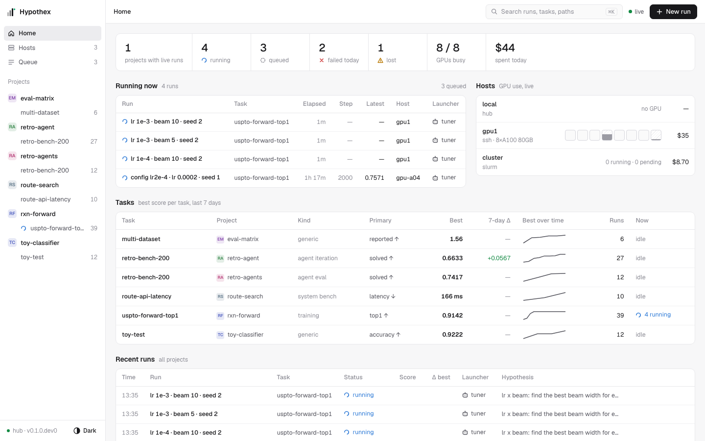
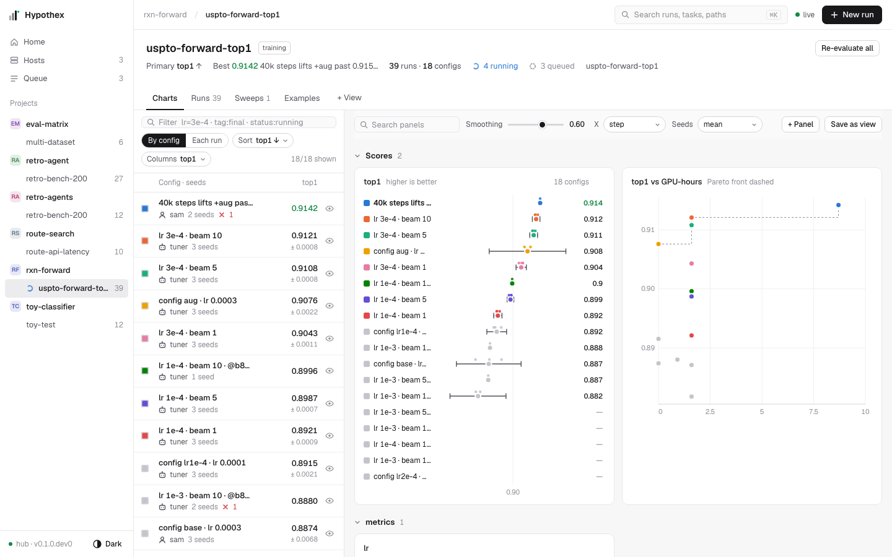
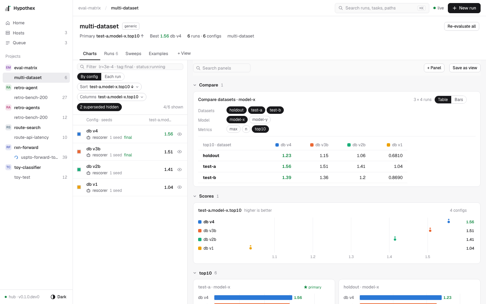
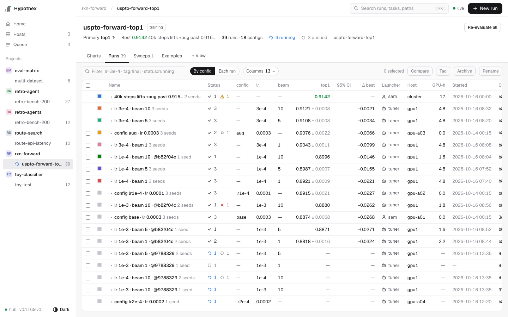
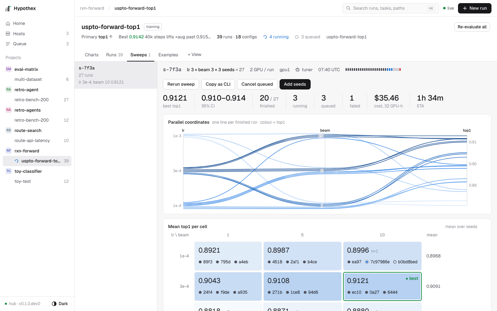
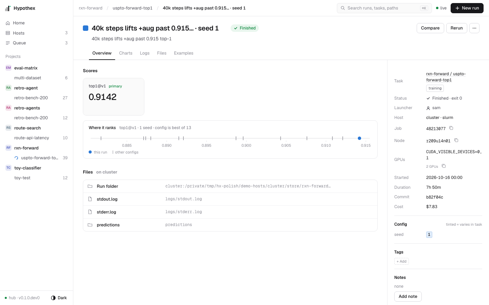
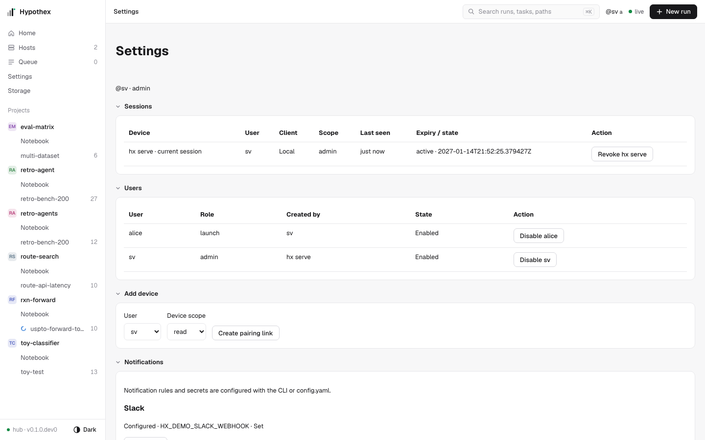
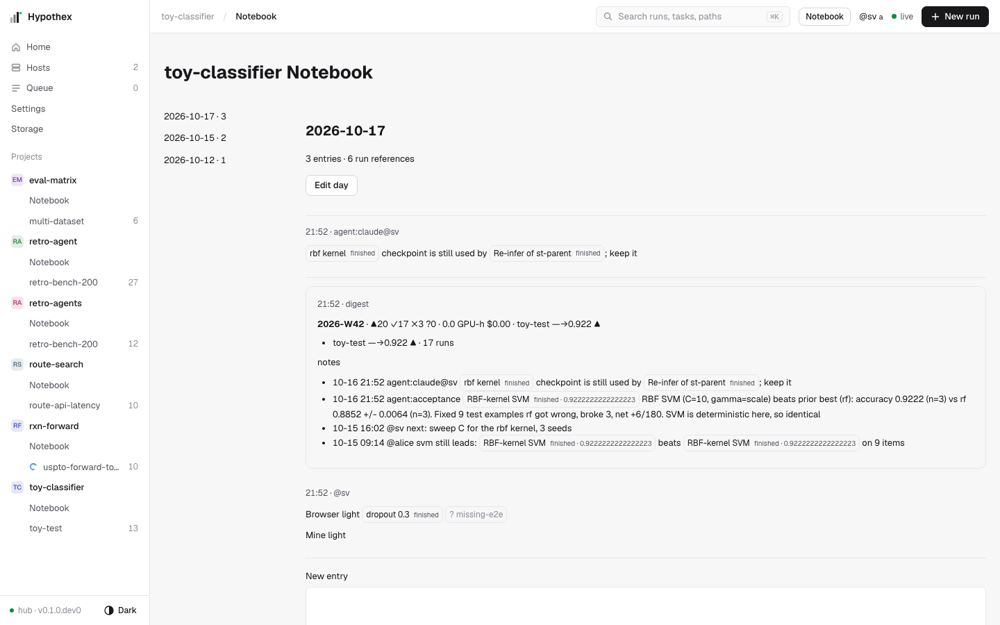
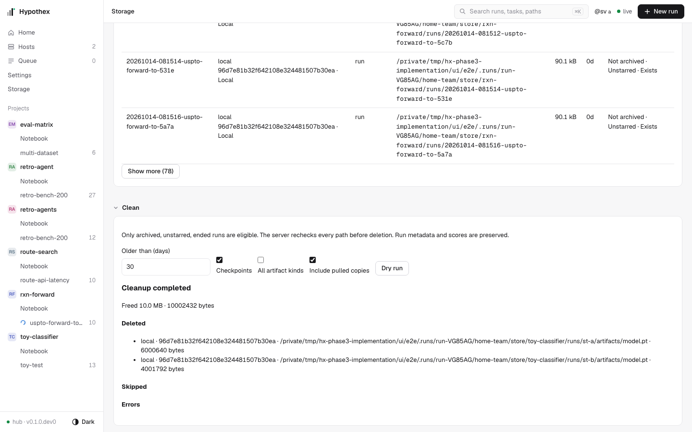

Web UI
======

``hx serve`` serves the web UI and the API on the same port (default
``http://127.0.0.1:7777``). The UI reads everything through ``/api/v1`` and stays live
over the ``/api/v1/ws`` event stream: a new run, score, note, rename or status change
refreshes the page you are looking at, without a reload.

A new tab starts its event stream after the hub's newest event, then refreshes its
page reads once. This covers changes made while the page was opening without
replaying the whole event log. Reconnects resume after the last received event.

.. code-block:: bash

   uv run hx serve

The UI first shows a Token field. In another terminal, run ``uv run hx token``
with the same Hypothex home and paste its output. The browser sends the bearer
in request headers and gets a fresh 30-second, single-use WebSocket ticket for
each connection. Credentials never appear in URLs. A server restart normally
rotates the token; a ``401`` clears cached data and returns to the gate. Explicit
loopback ``--no-auth`` servers open without a token.
Replacing the credential stops pending action retries and remaining seed launches;
newly selected credentials apply only to new actions. Already accepted runs continue.

Try it on demo data (a fresh home in ``/tmp``, fake hosts on this machine):

.. code-block:: bash

   uv run hx --home /tmp/hx-demo demo --with-hosts
   uv run hx --home /tmp/hx-demo serve

Shell
-----

Every page has the same frame. The left nav (216 px) lists **Home**, **Hosts** and
**Queue** with counts, then each project with its tasks, their run counts and a spinner on
tasks with running runs; ``⌘.`` (``Ctrl .``) hides or shows it. The top bar has the
breadcrumb (project / task / run), the search field (``⌘K``), the ``live`` indicator and
``New run`` (the Launch dialog). The colour-mode button at the foot of the nav switches
light and dark mode; both are equal.

Pages show numbers, not prose: tooltips explain a value, a glyph or a disabled button.

Colour rule
~~~~~~~~~~~

On a task page, one run identity has one colour in the run list, every chart, the Runs
table and the run page header. An identity is a config (``By config``, the default) or a
run (``Each run``). The visible identities take the 8 palette colours in list order; the
9th and later are neutral grey, and a hidden one shows an empty swatch. Hiding, filtering
or sorting the list therefore changes the colours, and every panel follows at once. Other chrome is grey;
colour also marks status (always with an icon) and best (green). Home tables show no
identity colour: colour belongs to one task.

Run names
~~~~~~~~~

A run is named by the params that differ inside its task (``lr 3e-4 · beam 10``,
``db v3``), computed on the hub so the UI, CLI and MCP agree; a run view adds its seed
(``· seed 2``). Two configs with the same visible params get the commit as well
(``lr 1e-4 · beam 10 · @b82f04c``). When nothing differs, the name is the first clause of the
hypothesis, then the first tag, then the short run id.

Rename a run in place: click the name on the run page, or the pencil (or a double click)
on a run list row. Enter saves, Escape cancels; a name is 1–80 characters on one line.
``Reset name`` (or saving the derived name or an empty name) drops the name. An invalid
name stays in the field with the error beside it; a name the hub refuses (for example,
its host is down) goes back to the old one and the error stays beside it. Renaming a
config renames each of its runs; a config shows the name of its most recently renamed run. A run on a host is
renamed on that host, through the hub. The same rename is ``hx rename`` (see
:doc:`cli`), the MCP tool ``rename_run`` (see :doc:`mcp`) and
``POST /api/v1/runs/{run_id}/name`` (see :doc:`http_api`).

Screens
-------

Home
~~~~

**Home** (``/``): a status strip (projects with live runs, running, queued, failed today,
lost, GPUs busy, spent today), then **Running now** (run, task, elapsed time, latest step,
latest primary value, host, launcher; the ``queued`` count links the Queue), **Hosts** (one
row per host with a GPU cell per device and cost today), **Tasks** (task, project, kind,
primary metric with direction, best, 7-day Δ, best over time, runs, now) and **Recent
runs** (time, run, task, status with the reason, score, Δ best, launcher, hypothesis;
failures have ``Open stderr`` and a copy button for the stderr path). Rows link to their
task or run. With hosts in ``environments.yaml`` (see :doc:`remote`), a host unreachable
for longer than ``stale_banner_hours`` (top level in ``environments.yaml``, default 24)
gets a banner (``dgx unreachable 1d``); its runs stay ``stale``, never ``lost``. Runs report
no total step count, so Running now has no progress bar or ETA.

Before the first run, Home shows ``No runs yet`` with three commands (``hx init``,
``hx run``, ``hx demo --with-hosts``) and links to the docs, the agent skill and adding a host.

Task
~~~~

**Task** (``/t/<project>/<task>?tab=<tab>``): a header with the task name, its kind and one
facts line (primary metric and direction, the best config's value and name, run and config
counts, running and queued runs, dataset; the Primary tooltip lists the metric versions)
and ``Re-evaluate all``. The tabs are ``charts`` (the default, no ``tab=``), ``runs``,
``sweeps``, ``examples``, then one tab per saved view (``view:<name>``, see :doc:`views`)
and ``+ View`` (the view editor). An old ``?view=<name>`` link opens that view's tab. On a
task page ``New run`` starts from the best config's latest run with the next unused seeds.

**Charts** has two columns: the runs sidebar and the panels.

The *runs sidebar* (340 px) is the one place that chooses runs; every panel on the page
follows it. It has the filter field, Group (``By config`` | ``Each run``), Sort and
Columns (the score each row shows), a ``N superseded hidden`` chip when runs carry the
``superseded`` tag (hidden by default; press it to show them) and ``N/M shown``. A row has
the colour swatch, the name, a sub-line (launcher, seed count or start time,
running/queued/failed counts, ``final`` in green) and the value (± sd for a config). The
eye hides the identity in every panel (an empty swatch, muted text). Hovering or focusing
a row highlights its lines in every chart. Click a row or press Enter on it to open its
run (a config opens its latest run); a modified or middle click opens a new tab.

Filter syntax (tokens split on spaces; all must hold; case-insensitive; spaces around
``=``, ``!=`` and ``:`` are ignored, so ``lr = 3e-4`` is ``lr=3e-4``):

.. list-table::
   :header-rows: 1
   :widths: 30 70

   * - Token
     - Keeps runs
   * - ``tag:final``
     - with that tag
   * - ``status:running``
     - with that status (``finished``, ``running``, ``queued``, ``failed``, ``killed``,
       ``lost``)
   * - ``by:agent``
     - by that launcher (``agent``, ``tuner`` and ``agent:tuner`` all match
       ``agent:tuner``)
   * - ``name:db*``
     - whose display name matches
   * - ``lr=3e-4`` or ``lr:3e-4``
     - whose param has that value; numbers compare by value, so ``lr=3e-4`` matches
       ``0.0003``
   * - ``model!=resnet*``
     - where that test fails; ``!=`` negates any form above (``tag!=final``)
   * - ``*``
     - matches any run of characters inside a value (``model:resnet*``)
   * - ``beam``
     - (a bare word) whose display or derived name contains it, or whose run id starts
       with it

The run list is in the URL, so a link shares it: ``filter=`` (the filter text),
``group=run`` (Each run), ``sort=<key>:<asc|desc>``, ``hide=<id>,<id>`` (hidden
identities), ``sup=1`` (show superseded runs) and ``col=<key>`` (the sidebar's value
column). Defaults stay out of the URL.

The *panel toolbar* has panel search (by title) and, when runs log step metrics,
Smoothing (EMA, value shown; raw lines stay faint), X (``step``, ``wall time``,
``relative time``) and Seeds (``mean``, ``mean + band``, ``each seed``; Repeats on system
benchmarks), then ``+ Panel`` and ``Save as view``. Panels sit in collapsible sections
(open state kept per task); a panel's tools show on hover: Full screen (Escape leaves
it), Edit and More.

- **Scores**: the primary metric as a dot with its 95% interval and the seed dots, one
  row per visible identity on one axis, the best interval as a green band; training tasks
  add score vs GPU-hours with the Pareto front. Single-seed runs without per-example
  scores show no interval; the tooltip says so.
- **Step metrics**: one line panel per logged metric, sectioned by the prefix before the
  first ``/`` (``train/``, ``val/``, ``sys/``). The crosshair is shared in a section; the
  tooltip lists every run at that step, sorted by value (at most 8).
- **Score keys** (more than one score key): keys split as ``<prefix>/<A>.<B>.<metric>``;
  one section per metric (the primary's first and open, the others closed), one bar panel
  per ``<A>.<B>`` (bars from zero in run colours, the value at the bar end, the best in
  green). Keys without dots form one section with a panel per key.
- **Compare** (eval tasks whose keys name two or more datasets; shown first): datasets
  side by side. Inside the panel pick Datasets (default the first four), Model (default
  the primary's; absent for ``<dataset>.<metric>`` keys) and Metrics (default the
  primary's); a chip group always keeps one value. ``Table | Bars`` switches between a
  table (one row per dataset, grouped under a metric row when several metrics are
  chosen; one column per visible run; the best value per row in green) and grouped bars
  (one facet per metric, zero-based, with a legend). ``+ Panel`` → Compare adds another
  one. A task can name the key parts in ``hypothex.yaml`` with
  ``score_keys: "{dataset}.{model}.{metric}"`` (see :doc:`project_file`); the controls
  then use those names.
- The task kind's preset panels (training curves, agent evaluation scatter, grid and
  trace, system benchmark distributions, agent iteration versions) in the same chrome.

``Save as view`` writes the shown panels, Compare panels included (view panel type
``compare``, see :doc:`views`), as a new view of the task and opens its tab. A view name
that is already taken is refused.

**Runs** (``tab=runs``): the full table with the same filter and Group. Columns: select,
swatch, name, status (counts per state for a config), each param that varies, the primary
mean ± sd, 95% CI, Δ best (muted inside the best interval), launcher, host, GPU-h,
started, commit and tags. A config expands to its seeds; headers sort; ``Columns`` hides
columns (kept per task). Actions on the checked rows: ``Compare`` (show only them on the
Charts tab), ``Tag``, ``Archive`` and ``Rename`` (one config or run at a time).

**Sweeps** (``tab=sweeps``; ``/s/<project>/<sweep_id>`` opens it with ``sweep=<id>``): the
task's sweeps, newest first, and the chosen sweep: its id, grid shape, hosts, GPUs,
launcher, start time and progress; the best cell, its 95% CI, finished, running, queued
and failed runs, cost and ETA; then **Parallel coordinates** (one line per finished run,
coloured by the primary metric), the mean per cell (a heat table for two params, a
sortable table otherwise), **What matters** (share of variance per param), **Best cell**
against the next one, and the sweep's runs on their hosts. Actions: ``Rerun sweep`` (the
best cell again, in the Launch dialog), ``Copy as CLI`` (the same ``hx sweep``),
``Cancel queued``, ``Add seeds`` (new seeds for every cell; after a failed try it proposes
the same seeds again, not the ones after them, and the hub starts only their missing runs)
and ``Resume``. Durable issuance state is separate from observed run counts. ``Resume``
uses the server's reported seeds; ``Cancel queued`` also drains accepted members that are
not mirrored yet, even after interrupted or incomplete issuance. Resume and Add seeds stay
disabled while cancellation is pending or settling.

**Examples** (``tab=examples``): two finished configs side by side, as on the Examples
page.

Run
~~~

**Run** (``/r/<run_id>?tab=<tab>``): a header with the identity colour (the same as on the
task page), the name, a status pill, ``Compare`` (the Examples page against the best other
config), ``Rerun`` and ``⋯`` (``Re-infer``, ``Re-evaluate``, ``Stop``, ``Archive``), then the
hypothesis. A renamed run shows its derived name in one muted line. Tabs: ``Overview``,
``Charts`` (every step metric, this run in colour and its seeds grey), ``Logs`` (stdout,
stderr or the supervisor log), ``Files`` and ``Examples``.

Overview: **Scores** (one tile per metric version; the primary first, older versions
marked; Δ against the config mean, muted when under one sd of its seeds), **Where it
ranks** (this run, its sibling seeds, the other configs and the best config's 95% interval
on one axis, with a summary such as ``2nd of 3 seeds · config is best of 12``), up to three
**Curves**, the kind's run panels and **Files** (run folder, logs, predictions,
checkpoints; Copy on hover). The properties sidebar (300 px) lists status (with exit code
or reason), launcher, host and GPUs, started, duration, commit, sweep, cost, then
**Config** (values that vary in the task tinted with the run's colour), **Tags** (Add),
**Notes** (inline editor), and the run id and folder.

A run on a host also shows where it runs (host, ``CUDA_VISIBLE_DEVICES``, SLURM job and
node), its place in the host queue while it waits, ``stale`` with the time since the hub
last heard from the host (never ``lost``: only the host decides that), why it was lost
(the reason from its ``run.lost`` event when the page saw that event, else what the
record says: job, node, end time, exit code), and its cost (``—`` when the host has no
``usd_per_gpu_hour``, so its GPU hours have no price). Times since a moment (waiting,
wall, unreachable) move on every 10 s while the run is not over, also when the host sends
nothing new. ``Re-infer`` is enabled only after the task confirms an ``infer`` stage;
``Re-evaluate`` reports how many runs were re-scored or skipped, with reasons. ``Stop``
asks for a second click. An old ``?log=stderr`` link opens the Logs tab on that stream;
``?example=<id>`` picks a traced example on agent tasks. A missing run shows ``Not found``
with a link to Home. Live SLURM GPU-hours use the requested GPU count when the job reports
no device indices.

Hosts and Queue
~~~~~~~~~~~~~~~

**Hosts** (``/hosts``): the hub itself (``local``, tag ``hub``), then one row per host
with its kind, GPUs, state, its hx version (``≠`` when it differs from the hub's), one cell
per GPU (agent run, human run, free, not hx), SLURM running and pending jobs, queue length
(links the Queue), ``$/GPU-h`` and cost today. ``Connect``, ``Reconnect`` and
``Disconnect`` act on one host; ``Reload`` reads ``environments.yaml`` again (after
``hx hosts add``, ``map`` or ``rm``). GPU use refreshes every 10 s. The hub reports GPUs only
for a connected host; when a host goes stale the page keeps the cells it last saw,
greyed, with ``as of HH:MM``.

**Queue** (``/queue``): every queued run, grouped by host in queue order, with its
position, task, launcher, GPUs, waiting time and status. ``Stop`` removes a run from the
queue after a second click.

Other screens
~~~~~~~~~~~~~

- **Launch dialog** (``New run`` in the top bar, ``Rerun sweep`` on a sweep): pick a
  host (the hub first, then every host with its free GPUs, queue and state; a host that is
  stale, still installing hx, or has no path for the project is disabled and says why),
  GPUs per run and ``wait for GPUs`` (SSH hosts) or partition, time and account (SLURM
  hosts; a blank field keeps the host's default from ``environments.yaml``), seeds
  (``4, 5, 6`` or ``1-3``), the command with ``{seed}``, and a required hypothesis. The
  preview shows the first seed's command as it will run. ``Copy as CLI`` copies the same
  ``hx launch`` lines. ``Launch N`` starts one run per seed; a double click still starts
  each seed once, and after a refused seed ``Launch`` sends only the seeds that did not
  start (and needs free GPUs only for those); the preview and ``Copy as CLI`` then show
  only those seeds too, so pasted lines never start a seed twice. A seed that got no answer
  may have started: the form locks, and ``Resend seed N`` sends that seed alone under the
  same id (also when its GPU now looks taken, maybe by that seed), until the hub answers
  with its run; then the form unlocks for the seeds after it. A launch on a host names the
  project; the hub pins the code (its checkout's commit and uncommitted diff), and
  ``Rerun sweep`` pins the template run's commit when that run had no uncommitted changes.
  ``New run`` proposes seeds after every seed of the template's config, archived runs
  included.
- **Examples** (``/x/<a>/<b>?metric=<name>``): what run B fixes and breaks against run A,
  with the paired sign test.
- **View editor** (``/t/<project>/<task>/edit/<view>``, ``new`` for a new view): YAML on
  the left with inline validation, a live preview on the right, then Save (writes
  ``.hypothex/views/<task>/<name>.yaml``) or Copy as CLI. A new view cannot take the
  name of a view that is already there: open that view to edit it.

Keyboard
--------

.. list-table::
   :header-rows: 1
   :widths: 30 70

   * - Key
     - Does
   * - ``⌘K`` (``Ctrl K``)
     - The command palette: go to Home, Hosts, Queue, a task or a run, copy a path, switch
       colour mode. Runs are listed by name; two or more typed characters also find renamed
       runs by their name or run id (``db v3``). Arrow keys move, Enter opens, Escape
       closes.
   * - ``⌘.`` (``Ctrl .``)
     - Hide or show the left nav.
   * - Tab, Enter
     - Rows of the runs sidebar are focusable; Enter opens the run. The eye, chips and
       segments are buttons with ``aria-pressed``.
   * - Enter, Escape
     - In a rename field: save, cancel.
   * - Escape
     - Clears the filter field; closes a menu; leaves a full-screen panel.

Paths wrap after slashes, preserving each segment and the exact copied path. Error
messages omit the API transport prefix on screen; the complete message remains in the
tooltip.

The task page reads one request, ``GET /api/v1/tasks/{project}/{task}/runs`` (every run
with its name, params, scores and config group), plus the leaderboard and the views. Run
charts request only the metric names they display, with at most 500 points per run and
metric. Implicit over-time charts leave out ``sweep/*`` series and their step-axis
metric; explicitly named series are preserved. Charts draw at their real pixel width, so
text stays the same size at every window width; axes use 1, 2, 2.5 or 5 × 10ⁿ ticks.

Kind panels
-----------

Examples outcome tables wrap long hypothesis labels within their own panel,
including labels without spaces. Counts and right/wrong labels remain visible
beside the sign-test chart at narrow widths. The Examples headline and run
summaries also wrap oversized tokens without shortening the displayed labels.

A view tab's Metric selector requests a new ranking for the selected recorded
``metric/key``. Direction, units, uncertainty and the headline follow that metric.
Seeds (Repeats for system benchmarks) toggles the leaderboard seed or repeat
marks while retaining the authored test-set interval. Selecting a run on training, agent evaluation, agent iteration or system
benchmark task pages opens its stored details; Open run opens the full route.
The selected detail heading receives focus and stays visible while delayed
charts finish loading. Scrolling, touching, clicking, typing, or moving focus
ends this automatic reveal so subsequent layout changes respect user navigation.

Training run and checkpoint tables page through twenty runs at a time. Best
checkpoint step comes from recorded ``val/top1`` checkpoint metadata. Evaluated
``top1/value`` and ``top1/final`` use the current configured metric version and are
separate from checkpoint validation measurements. Missing measurements remain
blank. GPU and memory columns show the last recorded observations; they do not
estimate peak use from a thinned history.

Agent run pages put the trajectory before the matching selected-example grid.
The grid matches actual example IDs and marks the current configuration; absent
outcomes remain unknown. Iteration comparison uses the latest run of each selected
group and compatible recorded evaluation provenance. It requests strict server
validation of the latest evaluation and exact per-example artifact bytes; stale
or unbound results remain unavailable. Its waffle counts shared scored example
IDs, without assuming that equal-sized datasets are identical.
System benchmark raw samples are scoped to the selected run and display at most
100 rows with the available total or an explicit unknown total.

Cost labels retain known recorded charges while marking incomplete GPU pricing.
An agent evaluation cost comparison requires complete pricing and matching metric
source, dataset identity and actual example-ID populations. System repeat warnings
require complete comparable per-run p95 latency observations; a warning marks a
repeat more than ten percent above the group's median. Missing coverage does not
produce an outlier claim.

Launch preparation and rerun preparation remain dismissible on loading or failure,
with retry available for failed reads. A failed best-template lookup does not
silently select a different configuration. Partial launches report confirmed runs;
unknown launch outcomes retain their command identity for reconciliation.

Build before packaging
----------------------

The built UI lives in ``src/hypothex/ui_dist/``, which git ignores. Build it before you
build the wheel, so the wheel ships it:

.. code-block:: bash

   cd ui && bun install && bun run build && cd ..
   uv build

Without ``ui_dist``, ``hx serve`` serves the API only, and the wheel has no UI.

Develop
-------

.. code-block:: bash

   uv run hx serve                 # API on 127.0.0.1:7777
   cd ui && bun run dev            # http://localhost:5173

The Vite dev server reloads on save and proxies ``/api`` (HTTP and WebSocket) to
``hx serve``. Use the same Token gate in development. Set
``HX_API=http://host:port`` to proxy to another server.

Regenerate the typed API paths from the running authenticated server:

.. code-block:: bash

   cd ui
   HYPOTHEX_HUB_TOKEN="$(uv run hx token)" bun run gen:types

The token helper must use the server's Hypothex home. ``HYPOTHEX_HUB_URL`` changes
the schema server (default ``http://127.0.0.1:7777``). The generator sends the
credential only as a header, refuses redirects, and leaves the existing types
file intact if fetching or parsing fails. Explicit no-auth servers need no token.

Test
----

.. code-block:: bash

   cd ui
   bun test                        # unit and component tests
   bun run build                   # the smoke tests use the built UI
   bunx playwright install chromium    # once
   bunx playwright test            # smoke tests, light and dark

Each ``bunx playwright test`` gets its own directory, ``ui/e2e/.runs/run-XXXXXX``
(``HX_E2E_RUN_DIR``), so two suites in one checkout never wipe each other's homes. It
seeds a fresh demo home in ``home`` there with ``hx demo`` and serves it with ``hx serve``
on a free port the OS picks for that run (never a fixed port, so it can never meet an
``hx serve`` you left running), so it never touches your own ``~/.hypothex``. The runner
hands the port to its workers and demo servers in ``HX_E2E_PORT`` (``HX_E2E_HOSTS_PORT``
for the hosts demo).

The ``hosts-*`` projects run against a second demo hub, seeded in ``home-hosts`` in the
same directory with ``hx demo --with-hosts`` (fake hosts that run on this machine), on its
own free port.
Both demo servers run with ``HYPOTHEX_SSH=false`` and ``HYPOTHEX_SCP=false``, so no test
can reach a real host. Playwright never reuses a server that already answers, stops at once
when a demo server cannot start, and every test first checks that the hub answers with the
identity written into its fresh home (``environment.json``), so no host route, note or
launch can reach another server. When a demo server stops, it waits for its hub's own
shutdown, then kills every process left under its own home (a hub that crashed or hung
leaves its fake hosts and runs behind), never the other demo server's.
``bun e2e/shutdown-check.ts`` stops the hosts demo three ways (SIGTERM, as Playwright
does; the hub killed; the hub stuck past the shutdown wait) and fails if a demo run or
fake host is left running.

Screenshots
-----------

The images on this page come from ``ui/scripts/screenshots.ts``: every screen in light and
dark at 1440×900, written to ``docs/_static/ui/<screen>-<theme>.png``. Run it against a
fresh demo hub in a ``/tmp`` home, served without a token:

.. code-block:: bash

   export HYPOTHEX_HOME=/tmp/hx-shots HYPOTHEX_SSH=false HYPOTHEX_SCP=false
   uv run hx demo --with-hosts
   uv run hx serve --port 7777 --no-auth       # leave running
   cd ui && HX_URL=http://127.0.0.1:7777 bun scripts/screenshots.ts

Team access and device pairing
------------------------------

**Pair** (``/pair``) is a public page without the application shell. Open the
single-use link produced by ``hx pair`` or **Settings**. Its fragment is removed
before redemption; enter a device name and choose Pair. Browser sessions use an
HttpOnly cookie, and the response contains no bearer token. After pairing, Home
loads the authenticated shell. Invalid, expired or already-used links require a
new offer. The original root Token field remains available for local owner access.
See :doc:`authentication` and :doc:`team` for session lifetimes and scopes.

The top bar identifies the current user and scope. Read scope can inspect runs,
exports and notebooks. Launch scope enables shared-host launches, notes, names,
tags and notebook edits; stopping, cancelling and archiving also require the run
owner or admin. Local execution and host administration require admin. Missing
legacy ownership is not guessed. Pending or failed identity reads disable actions.
On Home, **Mine** filters only Running now; Tasks, Recent runs and global totals
remain global. Runs and recent failures display their recorded owner.

**Settings** (``/settings``) lists sessions and marks this browser's current
session. Revoke ends that session; a revoked current session clears cached data and
returns to the Token gate. Admins also see Users, Add device and Notifications.
Pairing links remain only in the open offer panel, expire visibly, and are cleared
when you leave Settings. Notifications show delivery status and allow a test through the
configured Slack or email channel. See :doc:`notifications` and :doc:`configuration`.
A ``403`` displays the permission failure without locking the browser; ``401`` or
WebSocket ``4401`` stops retries and clears private queries and editor state.
Older servers lacking ``/auth/me`` retain their original screens after protected
transport validation, with new team features unavailable.

Notebook
--------

**Notebook** (``/n/<project>`` or ``/n/<project>/<day>``) opens the UTC day with a
calendar and previous/next navigation. Markdown entries preserve their author and
run links such as ``[[run:abc123]]``.
Missing targets remain readable. Add entry appends to the day; Edit day replaces
it using the loaded base hash. A concurrent change shows Mine and Theirs with
Use theirs, Keep mine or Copy mine, so an edit cannot silently overwrite another
writer. The latest editor attribution comes from live notebook events and clears
when the session changes. A 413 response retains the draft and reports the 1 MiB
limit. Weekly summary blocks preserve recorded totals and incomplete-cost
annotations. Read scope can browse but cannot submit edits. See
:doc:`notebook` for the equivalent CLI, SDK and MCP operations.

Exports and paper baselines
----------------------------

Task **Export** opens a preview with LaTeX, Markdown and CSV formats, noise and
digit options, and Copy and Download. A saved view uses its currently selected
primary metric. Export remains unavailable until that ranking has loaded; changes
invalidate the previous preview. Downloaded text is exactly the API response.
Copied or downloaded results never continue after a credential replacement. See
:doc:`export` for formatting and :doc:`views` for saved views.

Paper baselines are separate reference rows beneath measured Scores and compatible
leaderboards. Only the exact recorded metric key and version match. Authored
intervals are shown as supplied, with a paper reference and a non-ranking marker;
they do not count as runs, seeds, uncertainty estimates or winners. Missing values
stay blank. Sweep cost is unknown when the server does not declare complete
pricing; the tooltip retains the known recorded subtotal.

Storage and cleanup
-------------------

**Storage** (``/storage``) is admin-only and shows By project, By host and Largest.
Dry run creates a concrete plan with candidates, bytes and reasons. Apply opens a
confirmation requiring the exact integer ``total_bytes`` from that plan; rounded
display units are never accepted as the confirmation. The result reports actual
freed bytes, deleted items and skipped reasons, including a partially successful
application. Refresh or plan again after changed files invalidate a candidate.
See :doc:`storage` for policies and the immutable plan contract.

Deleted artifact markers retain historical metrics and display the cleanup time,
bytes and actor. A marker matches only the same filesystem environment and exact
path (or descendants), so a hub copy does not mark a host source deleted. Matching
file and checkpoint rows are struck through and no longer offer an existing-file
copy action. Re-infer is disabled when its selected checkpoint is known deleted.
Legacy markers without an environment stay unknown.

Team browser acceptance
-----------------------

The ``team-light`` and ``team-dark`` Playwright projects use separate disposable
homes seeded with ``hx demo --with-team``. Their servers disable SSH and SCP, use
fake notification receivers, and sanitize pairing fragments before logging. The
flows exercise cookie pairing, scope-specific Settings, notebook conflicts,
exported bytes, exact cleanup confirmation and deletion, and revoked sessions.
No screenshot is taken while a live pairing secret is visible. Existing UI v5
browser projects still cover the task/run shell, selection and scrolling behavior.
See :doc:`testing`, :doc:`sdk` and :doc:`mcp` for the shared acceptance contract.

.. code-block:: bash

   cd ui
   bunx playwright test --project=team-light --project=team-dark

Installed-package acceptance is described in :doc:`package-testing` and
:doc:`testing`. Its fresh wheel runs
outside the checkout and verifies restart plus upgrades from authentic schema 3
and schema 4 homes. SQLite rebuilds indexes to schema 5; PostgreSQL uses Alembic
migrations instead (see :doc:`configuration`). Host URL and Tailscale setup remain
in :doc:`remote`; :doc:`sdk` and :doc:`mcp` describe scoped clients and complete
versus unknown cost reporting.

The team acceptance screens below use disposable data. Both colour themes are
retained in ``docs/_static/ui``.

